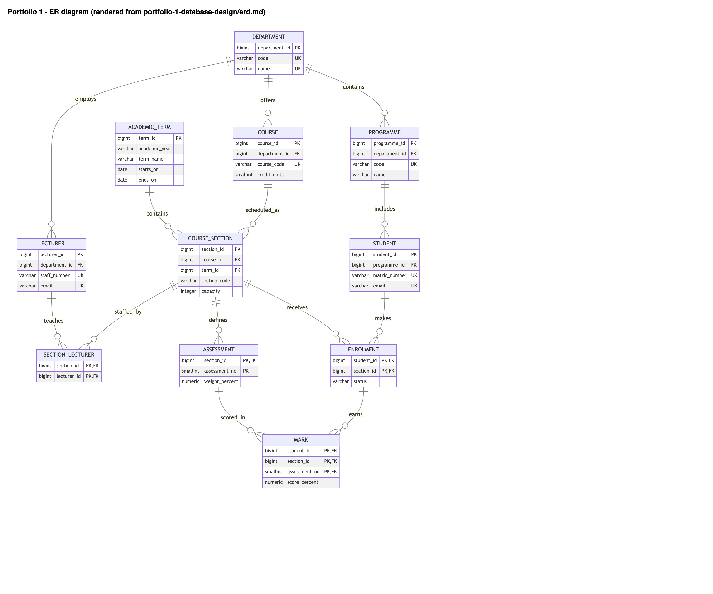
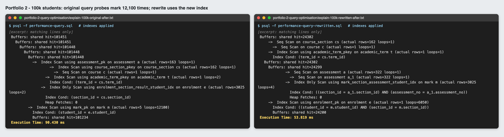
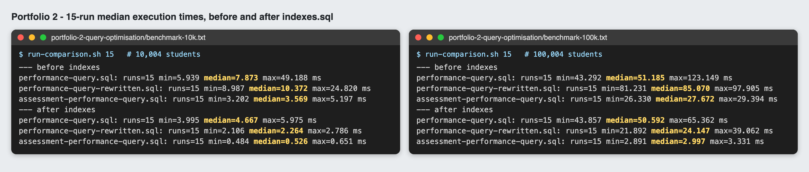
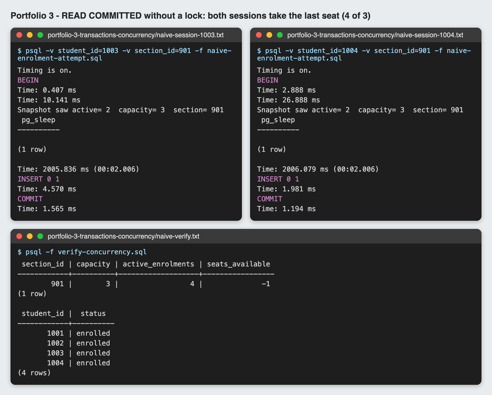
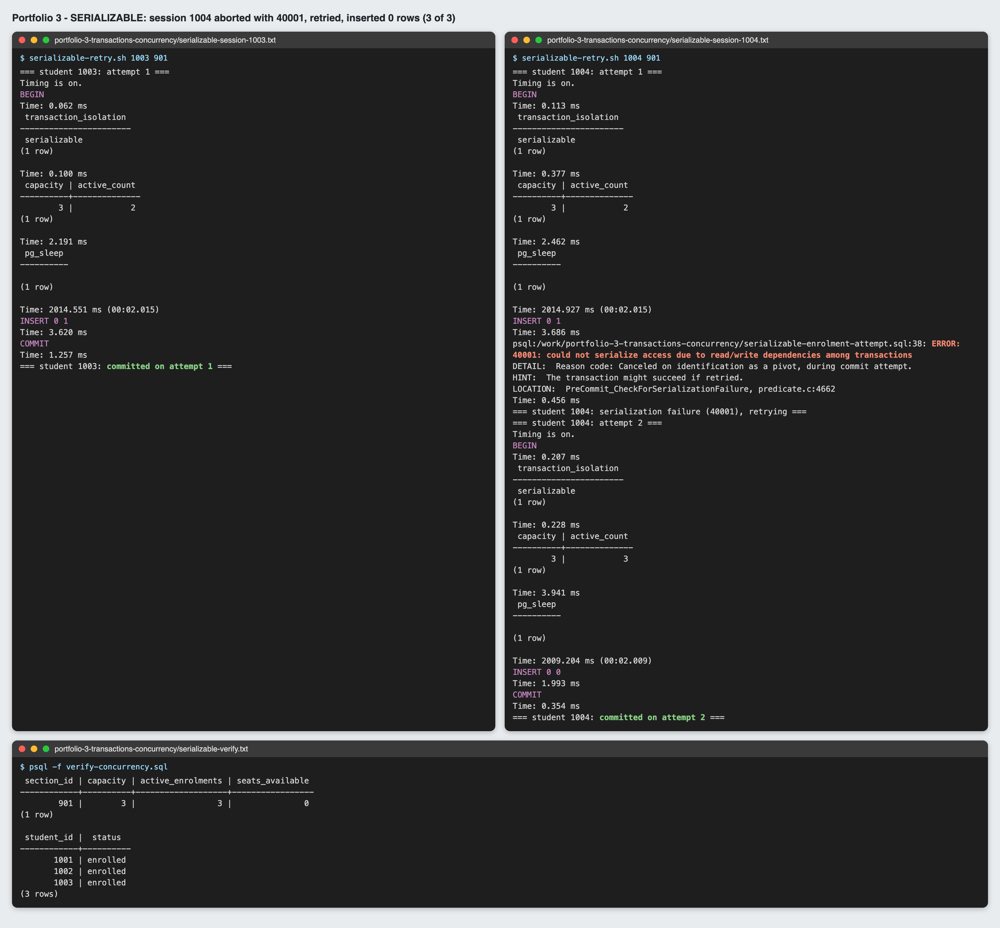
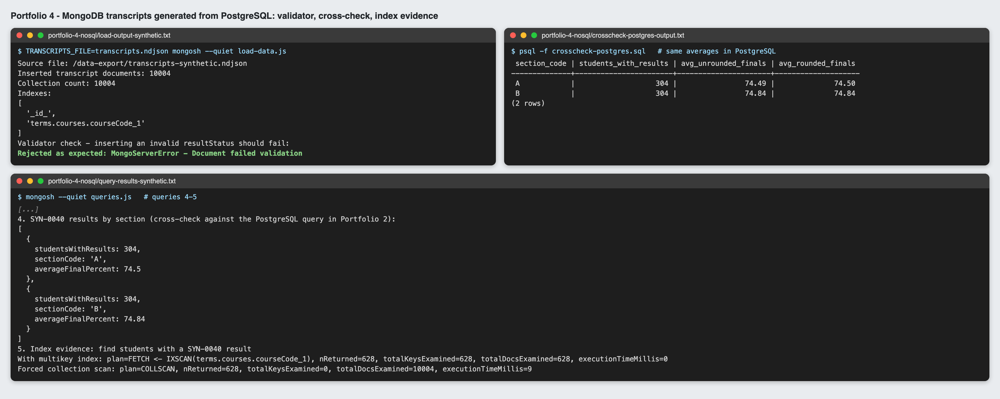
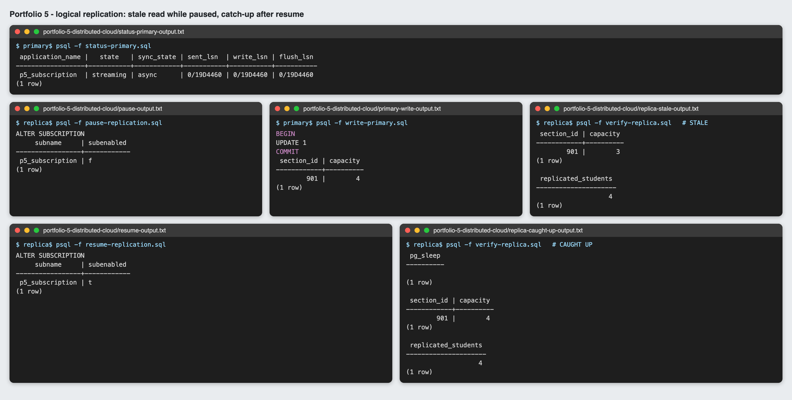
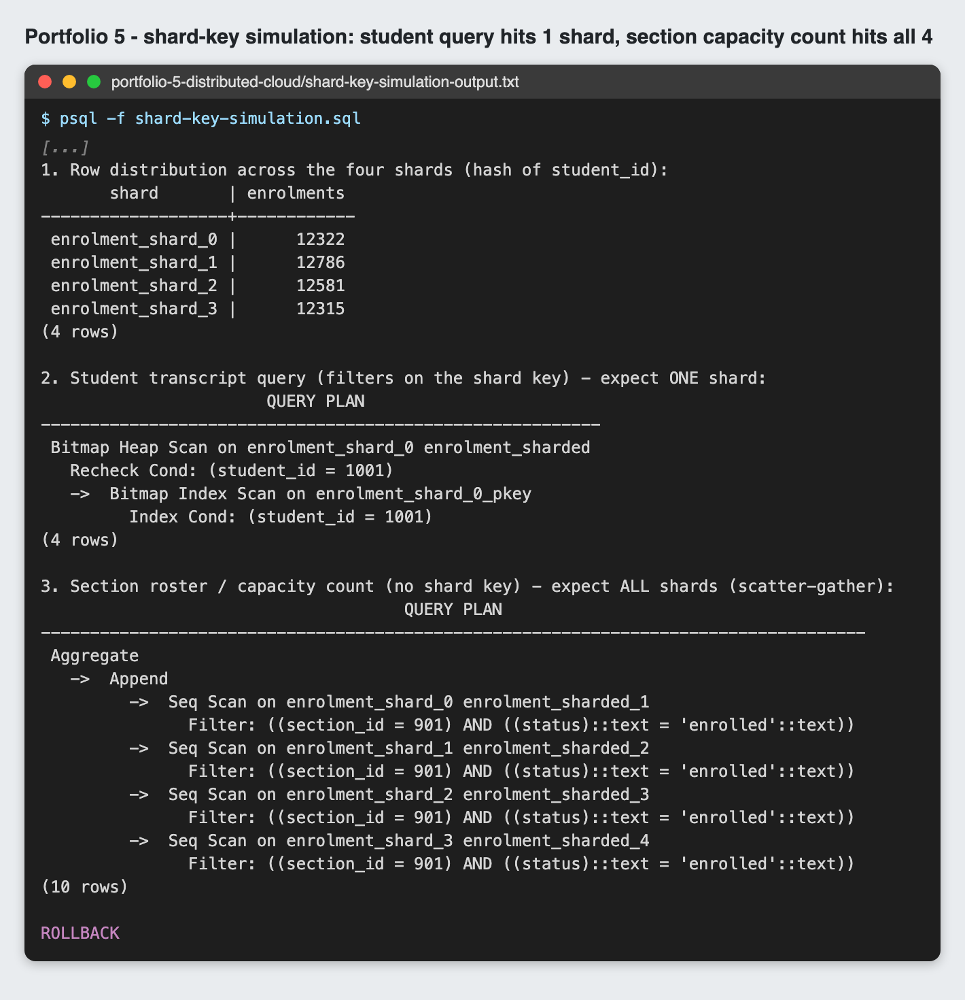

# MIT 8103 Advanced Database Systems — Portfolio Summary

**Student:** Oluwamayowa Adeoni  **Student ID:** 2026/A/MIT/0996
**Programme:** Master of Information Technology, 2026/2027 First Semester
**Repository:** <https://github.com/POPE001/mit-8103-advanced-database-portfolio>

## Selected case study

**University Course Registration and Results Portal** (simulated). The portal serves a mid-sized university. **Students** register for and drop course sections and view results. **Lecturers** enter assessment marks. **Department administrators** maintain courses, sections, and lecturer assignments. The **registrar** manages terms and official records. The database stores departments, programmes, students, lecturers, courses, academic terms, course sections, enrolments, assessments, and marks. Its key operations are: offering sections with a seat capacity; registering and dropping students without duplicates or overbooking; recording marks and deriving weighted final results; and retrieving a student's registrations and transcript. The same case study is used in all five activities ([CASE_STUDY.md](../CASE_STUDY.md)).

## Portfolio 1 — Database design and modelling

I designed an 11-table PostgreSQL 16 schema in 3NF ([ER diagram](../portfolio-1-database-design/erd.md), [schema](../portfolio-1-database-design/schema.sql), [normalisation](../portfolio-1-database-design/normalisation.md)). Many-to-many teaching is a `section_lecturer` junction table, and marks are rows rather than repeating columns. `mark` has composite foreign keys to both `enrolment (student_id, section_id)` and `assessment (section_id, assessment_no)`, so a mark can't belong to an assessment from a different section. The final percentage is derived (`SUM(score × weight) / 100`) rather than stored, which avoids update anomalies.

Two rules span multiple rows, so normalisation and `CHECK` constraints alone can't enforce them:

- **Drop-after-marks.** A trigger keeps marks earned before a drop but rejects any later insert, update, delete, or reassignment. The [edge-case run](../portfolio-1-database-design/edge-case-output.txt) shows four `PASS` rejections.
- **Result readiness.** A [validation query](../portfolio-1-database-design/validate-results.sql) flags sections whose weights don't total 100 and students with incomplete marks.

## Portfolio 2 — Query processing and optimisation

I generated a synthetic workload and compared `EXPLAIN (ANALYZE, BUFFERS)` plans before and after two indexes: a partial enrolment index and a covering `mark (section_id, assessment_no, student_id) INCLUDE (score_percent)` index. Because single timings were noisy (5.9–49.2 ms for the same query), I took **15-run medians** at two scales: 10k students (96,784 marks) and 100k students (967,754 marks) ([results](../portfolio-2-query-optimisation/run-results.md)).

- **Section assessment summary.** 3.57 → 0.53 ms at 10k and 27.67 → 3.00 ms at 100k: an index-only range scan with 0 heap fetches.
- **Weighted course-performance query.** Indexing alone gave **no gain at 100k** (51.19 → 50.59 ms). The plan showed why: 101,234 of 101,448 buffer hits came from 12,100 per-row `mark_pk` probes that could use only `student_id`. The enrolment index was used, but that part of the query was already cheap.
- **Query rewrite.** I rewrote the query to aggregate marks once per section and student. The new index was then used (85 buffers for all 12,100 marks), and the median halved to 24.15 ms at 100k (2.26 ms at 10k). The result is identical. Without the index, the rewrite is slower, so the gain comes from the index and the rewrite together.

## Portfolio 3 — Transactions and concurrency

[Commit and rollback](../portfolio-3-transactions-concurrency/transaction-examples-output.txt) were shown on student email updates. I then raced two students for the last seat in a 3-seat section ([results](../portfolio-3-transactions-concurrency/run-results.md)):

- **`READ COMMITTED`, no lock.** Both sessions read 2 active enrolments and both inserted, giving **4 enrolments for 3 seats**.
- **`SELECT ... FOR UPDATE` on the section row.** The second session waited about 1.58 s, then saw the committed seat and inserted 0 rows. The final count was 3/3.
- **`SERIALIZABLE` with a retry loop.** Both sessions read 2 and inserted without blocking. PostgreSQL's SSI aborted the second at `COMMIT` with **`40001` serialization failure**. Its retry saw 3/3 and inserted 0 rows.

I compared the two controls: pessimistic locking blocks, while optimistic SSI aborts and retries. For the registration path, I chose the row lock, because contention concentrates on a few known section rows.

## Portfolio 4 — NoSQL and advanced data models

I modelled student transcripts in MongoDB 7.0 as embedded documents (student → terms → courses → assessments) keyed by matriculation number, so a transcript is one document read ([model](../portfolio-4-nosql/model.md)). The documents are **generated from PostgreSQL** by a `json_agg` export, so the read model can't drift from the source. Pending and withdrawn results carry over correctly (for example, Ada Okafor's CSC8101 is `pending` because the section has no assessments yet).

- **Validation.** A `$jsonSchema` validator rejects invalid documents.
- **Scale and index evidence.** With all 10,004 students loaded, `explain()` showed the multikey index examining 628 documents, against 10,004 for a collection scan.
- **Cross-check.** MongoDB's SYN-0040 averages (304 students each; 74.50 and 74.84) match PostgreSQL. A [cross-check query](../portfolio-4-nosql/crosscheck-postgres-output.txt) shows that the 0.01 difference from Portfolio 2's 74.49 comes from storing per-student finals rounded to 2 dp.

The trade-off: embedding suits student-centred reads, while course-wide analytics stay in PostgreSQL.

## Portfolio 5 — Distributed and cloud database

I configured PostgreSQL 16 **logical replication** between publisher and subscriber containers (Docker Compose), which streamed asynchronously ([architecture](../portfolio-5-distributed-cloud/architecture.md), [results](../portfolio-5-distributed-cloud/run-results.md)). With the subscription paused, the primary changed section 901's capacity from 3 to 4 while the replica still returned 3. After resuming, the replica caught up to 4. This demonstrates eventual consistency and why read-after-write traffic must go to the primary.

A **shard-key simulation** (hash partitions on `student_id` standing in for 4 shards) spread the 50,004 enrolments evenly. `EXPLAIN` showed a transcript query touching 1 shard, while a section capacity count scattered to all 4. Sharding by student would turn the Portfolio 3 capacity check into a distributed transaction. My recommendation is therefore to stay on primary + replicas at this scale and, if needed, shard by `section_id` and serve transcripts from the Portfolio 4 read model. I also mapped the setup to a managed cloud deployment: a synchronous Multi-AZ standby for failover, asynchronous read replicas for reporting, and point-in-time recovery.

## Individual technical reflection

The main design choice was to keep PostgreSQL as the normalized source of truth for anything that must be correct (seat capacity, marks) and to derive read-optimized copies from it: the MongoDB transcript and the reporting replica. Each copy trades consistency for speed or convenience, and the portfolio measures that trade-off rather than just asserting it: the stale replica read, and the rounding difference in the cross-check.

Three lessons stood out:

- **Correct logic is not enough under concurrency.** The application-level capacity check was correct for one user but overbooked as soon as two ran together. The fix had to come from the database, either as a lock or as serializable isolation with retries.
- **An index only helps if the query's access path can use its leading columns.** At 100k students, the planner ignored a relevant index because of how the query was written, and only reading the plan's buffer counts showed where the time actually went.
- **Measure repeatedly.** The first single-run timings suggested a 21% gain that 15-run medians did not support at the larger scale.

The shard-key exercise showed that choosing a distribution key is really a decision about which invariant stays local.

The most challenging part for me was query optimisation. My first single-run timings suggested the indexes had worked, but when I repeated the runs at 100k students, the weighted query was no faster. I had to read the plan node by node, following the buffer counts, before I could see that the time was in the per-row `mark` lookups and not the part I had indexed.

Testing changed the portfolio in three places:

- I rewrote that query so the new index could be used.
- My first MongoDB documents were typed by hand and disagreed with the PostgreSQL data, so I replaced them with documents generated from PostgreSQL.
- I added the `SERIALIZABLE` run so that isolation levels, not just locking, were demonstrated.

Next, I would add a deadlock demonstration, replace the manual MongoDB export with a change-data-capture feed, and deploy the replication setup to a real managed cloud service rather than local containers.

## References

- PostgreSQL 16 Documentation: [Explicit Locking](https://www.postgresql.org/docs/16/explicit-locking.html); [Transaction Isolation](https://www.postgresql.org/docs/16/transaction-iso.html); [Using EXPLAIN](https://www.postgresql.org/docs/16/using-explain.html); [Index-Only Scans](https://www.postgresql.org/docs/16/indexes-index-only-scans.html); [Logical Replication](https://www.postgresql.org/docs/16/logical-replication.html); [Table Partitioning](https://www.postgresql.org/docs/16/ddl-partitioning.html).
- MongoDB 7.0 Manual: [Embedded Data](https://www.mongodb.com/docs/v7.0/data-modeling/embedding/); [Multikey Indexes](https://www.mongodb.com/docs/v7.0/core/indexes/index-types/index-multikey/); [Schema Validation](https://www.mongodb.com/docs/v7.0/core/schema-validation/); [explain results](https://www.mongodb.com/docs/v7.0/reference/explain-results/).
- Ports, D. R. K. and Grittner, K. (2012). Serializable Snapshot Isolation in PostgreSQL. *Proceedings of the VLDB Endowment*, 5(12).
- Software: PostgreSQL 16.14, MongoDB 7.0.45, Docker Compose, Mermaid (ER diagram rendering). All data is synthetic; no external datasets were used.

## AI-use declaration

- **Tools:** OpenAI Codex and Anthropic Claude Code (Claude Opus 5.5).
- **What they were used for:** planning the portfolio structure; drafting and debugging SQL, MongoDB, and shell scripts; extending the evidence (the `SERIALIZABLE` run, median benchmarks and query rewrite, the PostgreSQL-to-MongoDB export, the shard-key simulation); rendering screenshots from captured output; and editing the documentation and this summary.
- **How the output was verified:** every script was executed in disposable PostgreSQL 16.14 and MongoDB 7.0.45 containers, and the captured output is committed next to the script. Results were cross-checked: the rewritten query returns the same rows as the original, and the MongoDB averages were reproduced in PostgreSQL, with the 0.01 difference traced to rounding. I have read the scripts and outputs and can explain the design choices, plans, and results.
- I remain responsible for the accuracy and originality of the submitted work.

## Appendix — Selected evidence

All screenshots are in [final-documentation/screenshots](screenshots/). Each panel names the committed output file it shows.

