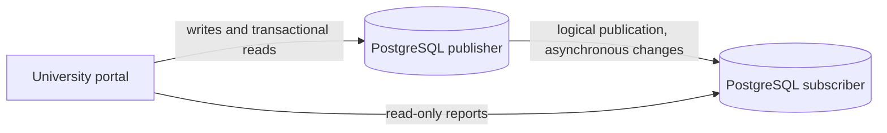

# PostgreSQL Logical Replication Architecture

## Case-study use

The primary hosts the university registration and results database. The application sends enrolment changes, mark updates, and administrative writes to the primary. Reporting requests can read from the subscriber to reduce read load on the primary.

The Compose setup uses logical replication for the Portfolio 1 tables. The subscriber receives an initial table copy, then changes from the publication. The two local containers model separate database nodes on a private network.

## Consistency and availability

- Replication is asynchronous by default. A read sent to the subscriber may be stale until the apply worker catches up. Read-after-write actions such as confirming a newly registered course should go to the primary or wait for a replication position.
- If the subscriber is paused or disconnected, the primary can continue accepting writes, but subscriber reads become increasingly stale. The run check demonstrates this by pausing replication, changing a section's capacity on the primary, reading the old capacity from the subscriber, and then resuming replication.
- A subscriber can serve reads during a primary outage only for data it has received. This logical subscriber is not an automatic failover target. Promotion and application routing require an operator or orchestration layer.
- The application should use a read-only role for subscriber traffic. This demo uses the local `postgres` account for administration and does not expose database ports to the host.

## Limits of the demo

PostgreSQL logical replication does not replicate schema changes or sequence state. Schema changes must be applied to both nodes, and sequence values need separate handling before any planned promotion. The subscriber is kept read-only at the application level in this exercise. These are reasons a production deployment would need a documented failover and schema-change procedure.

## Sharding: choosing a shard key for the portal

Replication copies the whole database to every node. Sharding instead splits rows across nodes by a shard key, so each node holds only part of the data. [shard-key-simulation.sql](shard-key-simulation.sql) models four shards on one PostgreSQL node using hash partitions. PostgreSQL routes each row by the hash of the key, as a sharded system such as Citus would, and partition pruning in `EXPLAIN` shows which shards each query has to visit. Run against the 50,004 Portfolio 2 enrolments, hash-partitioned on `student_id` ([output](shard-key-simulation-output.txt)):

- **Even distribution.** The shards held 12,322 / 12,786 / 12,581 / 12,315 rows, so hashing a high-cardinality key avoids hot shards.
- **Shard-key query.** The student transcript query (`WHERE student_id = 1001`) touched **one shard**: `Bitmap Heap Scan on enrolment_shard_0`.
- **Non-key query.** The section capacity count (`WHERE section_id = 901`) had to **scatter to all four shards** (`Append` over shards 0–3) and gather the results.

This trade-off decides the design:

| Shard key | Single-shard operations | Cross-shard operations | Consequence for the portal |
| --- | --- | --- | --- |
| `student_id` | Transcript, a student's registrations | Section rosters, capacity check, course reports | **Breaks the Portfolio 3 capacity guarantee.** One section's enrolments are spread across shards, so "count active seats, then insert" becomes a distributed transaction that needs two-phase commit or a global lock. |
| `section_id` (co-located with `course_section`, `assessment`, `mark`) | Enrolment, capacity check, mark entry, section reports | A student's transcript (spread across their sections) | The capacity lock and the mark-protection trigger stay local to one shard, as tested. Transcripts become scatter-gather. |
| `term_id` | Everything within one term | Multi-term transcripts | Very uneven load: all registration-day traffic hits the current term's shard. |

**Recommendation.** At this portal's scale, one primary with read replicas (the setup demonstrated above) is enough, so sharding isn't justified yet. If write volume grew beyond one primary, I would shard by `section_id`, keeping each section with its assessments, enrolments, and marks. That keeps the correctness-critical write path (capacity check and mark entry) on a single shard. The cross-shard read (a student's transcript) would be served by the Portfolio 4 MongoDB read model, whose documents are keyed by student. Each store is then partitioned by the key its main access pattern uses.

## Cloud deployment

The local Compose setup maps onto a managed cloud deployment:

| Concern | Local demo | Cloud deployment |
| --- | --- | --- |
| Primary database | `primary` container | Managed PostgreSQL (for example, Amazon RDS, Google Cloud SQL, or Azure Database for PostgreSQL) in a private subnet |
| High availability | Not provided: the logical subscriber is not a failover target | A synchronous standby in a second availability zone with automatic failover. Commits are acknowledged only after the standby has them, so a zone failure loses no committed enrolments (RPO ≈ 0), at the cost of extra commit latency. |
| Read scaling | Logical subscriber for reporting reads | Asynchronous read replicas for transcripts and reports. They have the same stale-read window shown in the pause test, so read-after-write paths stay on the primary. |
| Backups | None (disposable volumes) | Automated snapshots plus WAL archiving for point-in-time recovery, for example to before an erroneous bulk mark update |
| Transcript read model | Disposable MongoDB container | A managed MongoDB service, refreshed from PostgreSQL by change data capture |
| Credentials | Fixed demo password | A secrets manager, TLS connections, and separate read-only roles for replica traffic |

The two replication modes make the consistency trade-off explicit. Synchronous replication to the HA standby favours consistency and durability. Asynchronous replication to read replicas favours availability and low latency, and accepts the bounded staleness measured in this exercise. Registration-day peaks mostly add reads (students checking timetables and results), which can be absorbed by adding replicas. The write peak on popular sections is handled by short row-level locks on the primary (Portfolio 3), not by adding nodes.

## References

- [PostgreSQL logical replication](https://www.postgresql.org/docs/16/logical-replication.html)
- [PostgreSQL publications](https://www.postgresql.org/docs/16/logical-replication-publication.html)
- [PostgreSQL subscriptions](https://www.postgresql.org/docs/16/logical-replication-subscription.html)
- [Logical replication restrictions](https://www.postgresql.org/docs/16/logical-replication-restrictions.html)
- [PostgreSQL table partitioning (hash partitioning and partition pruning)](https://www.postgresql.org/docs/16/ddl-partitioning.html)
- [PostgreSQL high availability, load balancing, and replication](https://www.postgresql.org/docs/16/high-availability.html)
